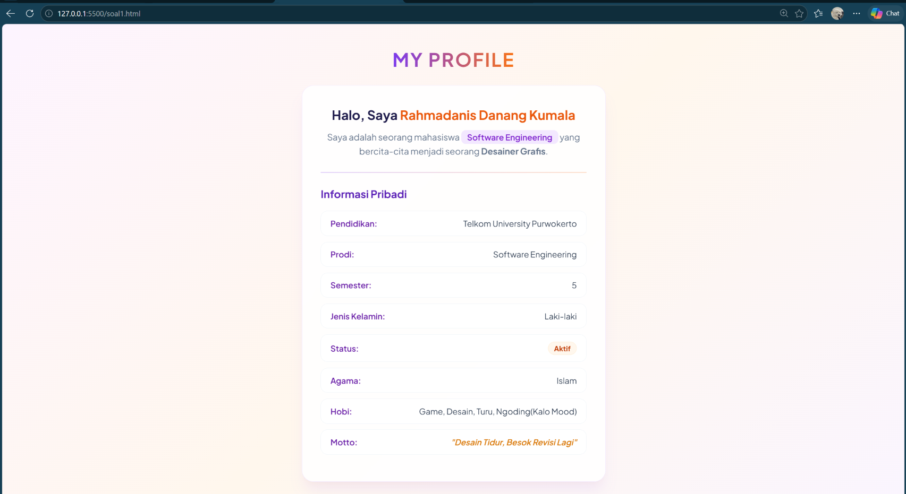
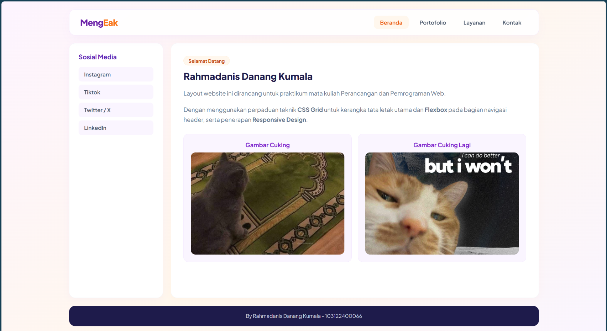

# MODUL 03 - CSS

### Nama : Rahmadanis Danang Kumala
### Kelas : SE 08 02
### NIM : 103122400066
### -----------------------------------------------

### SOAL 1 - Halaman Profil Sederhana
Halaman profil ini dibuat dan diberi styling menggunakan CSS dengan memanfaatkan beberapa konsep dasar, yaitu:

1. **CSS Selector & Tipografi:** Mengatur jenis font, ukuran, ketebalan, dan warna teks pada heading dan paragraf.
2. **Layouting dengan `
` & ``:** Mengelompokkan elemen profil ke dalam bentuk *card* serta memberikan *highlight* khusus pada teks.
3. **Styling List:** Menata daftar informasi pribadi (`<ul>` / `<li>`) agar tampil rapi tanpa *bullet points* default.
4. **Color & Alignment:** Menerapkan skema warna modern (kombinasi Ungu dan Orange) serta perataan teks yang presisi.

---

### SOAL 2 - Layout Website Responsive
Layout website sederhana ini dirancang menggunakan kombinasi teknik modern CSS, yaitu:

1. **Flexbox:** Digunakan pada bagian *Header / Navbar* untuk menyusun menu navigasi secara horizontal dan berubah vertikal saat di layar HP.
2. **CSS Grid:** Mengatur kerangka tata letak utama halaman yang terdiri dari *Header*, *Sidebar*, *Konten Utama*, dan *Footer*.
3. **Cards & Responsive Images:** Menampilkan kartu galeri dengan gambar yang menyesuaikan ukuran kontainer secara otomatis (*fluid/responsive*).
4. **Responsive Design (Media Query):**
   - **Desktop:** Menampilkan navigasi horizontal dan layout multi-kolom (*sidebar* & *content* bersandingan).
   - **Tablet:** Menyesuaikan ukuran kolom grid serta proporsi gambar agar fleksibel.
   - **Mobile:** Mengubah seluruh tata letak menjadi 1 kolom vertikal dari atas ke bawah agar nyaman dilihat di layar smartphone.

---

### OUTPUT 

**SOAL 1**

**SOAL 2**

